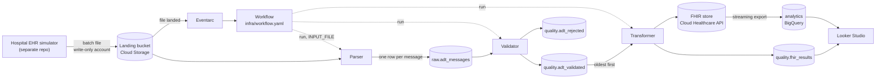

# HL7v2 ADT → FHIR R4 on Google Cloud

A proof of concept of a healthcare data pipeline: a regional analytics hub receives **HL7v2 ADT**
feeds (admit, update, discharge) from hospitals running a legacy EHR, lands them unchanged,
quarantines records that miss mandatory fields, converts the rest to **FHIR R4**, and reports
weekly patient flow.

**Small data, big-data shape.** The data is tiny on purpose (a week of two hospitals is about
250 messages; at most 50 rows on the dashboard). The components and their
wiring are the ones you would use at scale. All data is synthetic.

Design notes: [docs/ARCHITECTURE.md](docs/ARCHITECTURE.md).

## Results (deployed on GCP, October 2026)

A week of synthetic ADT traffic from two hospitals, sent by an external EHR simulator and processed
end to end with no manual steps (file lands → Eventarc → Workflow → three Cloud Run jobs):

| Measure | Value |
|---|---|
| Batch files | 17, every one reconciled (raw = validated + rejected) |
| HL7 messages | 303 |
| Quarantined with a reason | 4 (missing visit number or MRN, injected on purpose) |
| Written to the FHIR store | 260 |
| Skipped by newest-message-wins | 39 (late or repeated messages that would have overwritten newer data) |
| FHIR write failures | 0 |

What each design principle looks like in practice:

| Principle | Where | Evidence |
|---|---|---|
| Durable layer between steps | bucket → `raw` → `quality` → FHIR store | A failed transformer run was fixed and re-run alone; parser and validator results were untouched |
| Idempotency | hash-keyed MERGE, conditional FHIR upserts | Re-uploading a file adds no rows and no resources |
| Ordering / newest wins | MSH-7 check before every write, `If-Match` on updates | Late admits after a discharge are skipped; the encounter stays `finished` |
| Failure isolation | `quality.adt_rejected` with reasons | Bad messages are quarantined while the rest of the file flows on |
| Least privilege at the boundary | write-only `hospital-sender` account | The hospital can create files in the bucket and nothing else |
| Observability | JSON logs with MSH-10, `quality.pipeline_health`, `quality.message_journey` | Any message can be followed from file to FHIR resource |
| Interoperability | FHIR R4 store + BigQuery streaming export | Patient-flow views read data that came back out of the FHIR store |

Screenshots: `docs/screenshots/` · Dashboard: *link to Looker Studio report*

## Services

Plain Node.js (CommonJS), one folder per service, one shared `config.js`. All three run as
**Cloud Run jobs** from one container image, as the `hl7-pipeline` service account. A
**Cloud Workflow** runs them in order for each landed file; an **Eventarc** trigger starts it.

| Service | Folder | Input → output |
|---|---|---|
| Parser | `services/parser` | landed batch file → `raw.adt_messages` (one row per message, keyed on a SHA-256 hash) |
| Validator | `services/validator` | `raw.adt_messages` → `quality.adt_validated` + `quality.adt_rejected` (with reasons) |
| Transformer | `services/transformer` | `quality.adt_validated` → FHIR store (newest message wins) + `quality.fhir_results` |
| Dashboard | Looker Studio | `analytics` (streamed from the FHIR store) + `quality.pipeline_health` |

| Shared | File | What it holds |
|---|---|---|
| Config | `config.js` | every setting, from env vars (or `.env` locally) |
| HL7 helpers | `lib/hl7.js` | batch splitter by MSH, parser (CR, LF or CRLF), field readers, timestamps |
| GCP clients | `lib/storage.js`, `lib/bigquery.js`, `lib/fhir.js` | read a landed file; idempotent MERGE into BigQuery; FHIR search and transactions |
| Logging | `lib/log.js` | one JSON line per entry, with file and MSH-10 (correlation ID) |
| Deployment | `Dockerfile`, `infra/` | image, `workflow.yaml` (orchestrator), `deploy.sh`, `views.sql` |

The hospital (EHR simulator) is a separate system in its own repo: it uploads batch files to the
landing bucket with a write-only service account.

## Workflow at service level



The workflow passes only the file path (control); each job reads its data from the layer before
it (data). Every job is idempotent, so any step can be re-run for a file on its own.

## Example data, step by step

Real output from `data/sample.hl7` (2 patients + 1 malformed message). Control IDs and timestamps
change on every generation.

**1. EHR simulator → `data/sample.hl7`.** One patient's admit (A01), as the legacy EHR sends it:

```
MSH|^~\&|SYN-HIS|SYNH-BLR|PIPELINE|PIPELINE|20261020130501||ADT^A01^ADT_A01|SIM590330620000|P|2.5
EVN|A01|20261020130501
PID|1||MRN110867^^^SYNH-BLR^MR~09-8211-3542-6123^^^ABDM^ABHA||Prajapat^Balagopal||19820202|M|||1610 Reddy-Ganaka Club^^Mangaluru^Karnataka^575641^IN||+915092635519
PV1|1|O|OPD^R33^B2||||D8325^Rana^Ahalya||||||||||||V7985901|||||||||||||||||||||||||202610201305
```

The file holds 7 messages: this patient's A01 → A08 (phone changed) → A03, the same for a second
patient, and one emergency admit whose PV1-19 (visit number) is empty.

**2. Parser → `raw.adt_messages`.** One row per message, stored unchanged, with a hash as the
idempotency key (reloading the same file creates nothing new):

```json
{ "msg_no": 1, "file_name": "sample.hl7",
  "message": "MSH|^~\\&|SYN-HIS|SYNH-BLR|PIPELINE|PIPELINE|20261020130501||ADT^A01…",
  "message_hash": "d65db8213a0aaae2eaf5967c744468cb3834c1c776f2f640e46c98c096171522",
  "loaded_at": "2026-10-22T08:50:33.188Z" }
```

**3. Validator → `quality.adt_validated` (6 rows) and `quality.adt_rejected` (1 row).**

```
VALID    #1 SIM590330620000 A01
VALID    #2 SIM590330620001 A08
VALID    #3 SIM590330620002 A03
VALID    #4 SIM590330620003 A01
VALID    #5 SIM590330620004 A08
VALID    #6 SIM590330620005 A03
REJECTED #7 SIM590330620006 A01  PV1-19 (visit number) is required
```

```json
{ "msg_no": 7, "control_id": "SIM590330620006", "trigger_event": "A01", "mrn": "MRN310560",
  "rules": "required_field:PV1-19", "reason": "PV1-19 (visit number) is required", "message": "…" }
```

**4. FHIR transformer → FHIR store.** Messages are applied oldest first. For the discharge (A03)
the bundle upserts the Patient and finishes the Encounter (abridged):

```json
{ "resourceType": "Bundle", "type": "transaction", "entry": [
  { "fullUrl": "urn:uuid:32460f7f-4741-5c4c-b3d7-07e0038cd5d4",
    "resource": { "resourceType": "Patient",
      "extension": [{ "url": ".../source-message-time", "valueDateTime": "2026-10-20T14:05:01+05:30" }],
      "identifier": [{ "system": "urn:syn:synh-blr:mrn", "value": "MRN110867" },
                     { "system": "https://healthid.ndhm.gov.in", "value": "09-8211-3542-6123" }],
      "name": [{ "family": "Prajapat", "given": ["Balagopal"] }],
      "gender": "male", "birthDate": "1982-02-02",
      "telecom": [{ "system": "phone", "value": "+917108777031" }] },
    "request": { "method": "PUT", "url": "Patient?identifier=urn%3Asyn%3Asynh-blr%3Amrn%7CMRN110867" } },
  { "fullUrl": "urn:uuid:20596f25-db46-534e-a400-5c6e880014fe",
    "resource": { "resourceType": "Encounter",
      "identifier": [{ "system": "urn:syn:synh-blr:visit", "value": "V7985901" }],
      "status": "finished", "class": { "code": "AMB" },
      "subject": { "reference": "urn:uuid:32460f7f-4741-5c4c-b3d7-07e0038cd5d4" },
      "period": { "start": "2026-10-20T13:05:00+05:30", "end": "2026-10-20T14:05:00+05:30" } },
    "request": { "method": "PUT", "url": "Encounter?identifier=urn%3Asyn%3Asynh-blr%3Avisit%7CV7985901" } } ] }
```

Each message's result against the store (also recorded in `quality.fhir_results`):

```
SENT    SIM590330620000 A01 MRN110867  201 Created Patient/3/_history/1 | 201 Created Encounter/4/_history/1
SENT    SIM590330620001 A08 MRN110867  200 OK Patient/3/_history/2
SENT    SIM590330620002 A03 MRN110867  200 OK Patient/3/_history/3 | 200 OK Encounter/4/_history/2
```

Sending the same messages again changes nothing, and a late A01 after the discharge is skipped, so
the encounter stays `finished`:

```
SKIPPED SIM590330620000 A01 MRN110867  Encounter/4: stored version is from the same or a newer message
```

**5. FHIR store → `analytics`.** The store's streaming export appends a row per resource version to
BigQuery. `analytics.encounters_current` keeps the latest version of each encounter and
`analytics.daily_flow` counts admissions and discharges per day, hospital and class.

**6. Dashboard.** Looker Studio, three pages: pipeline health (`quality.pipeline_health`), patient
flow (`analytics.daily_flow`, `analytics.encounters_current`) and a message explorer
(`quality.message_journey`: one row per HL7 message, its outcome and the original text).

## Deploy

Needs a GCP project with billing, `gcloud` (signed in as a project owner) and Node 22.

```bash
npm install
PROJECT=<project-id> ./infra/setup.sh      # once: bucket, datasets, FHIR store, service accounts
PROJECT=<project-id> BUCKET=<project-id>-landing HC_DATASET=hl7-fhir FHIR_STORE=fhir-r4 ./infra/deploy.sh
bq query --use_legacy_sql=false < infra/views.sql
```

`deploy.sh` builds the image, deploys the three jobs, the workflow and the trigger. Tables are
created by the jobs on first run. Upload a batch file to the bucket and follow it:

```bash
gcloud workflows executions list hl7-pipeline --location=asia-south1 --limit=5
bq query --use_legacy_sql=false 'SELECT * FROM quality.pipeline_health ORDER BY loaded_at DESC'
```

The FHIR resources themselves: console → Healthcare → the dataset → the FHIR store → **FHIR viewer**
(each resource's History tab shows its versions, e.g. admit → discharge).

Deployment is a scripted gcloud flow. The production path would be Terraform for the infrastructure
and GitHub Actions deploying on merge.

To run one job by hand, re-run it for a file: `gcloud run jobs execute validator --region=asia-south1
--update-env-vars=INPUT_FILE=<object path>`.

## How it got here

1. **Manual run.** Every step done by hand in the console, Cloud Shell and BigQuery SQL, to learn
   each service before automating it (findings 1–7).
2. **Code.** The steps rewritten as three small services with shared HL7 and GCP helpers.
3. **Deployment.** `infra/deploy.sh`, the workflow and the trigger, then the week of data run end
   to end (findings 8–14).

Environment: project `hl7-fhir-pipeline`, region `asia-south1` for everything, BigQuery datasets
`raw`, `quality`, `analytics`, Healthcare dataset `hl7-fhir-pipeline-landing-fhir`, FHIR R4 store with
*update-create* and *referential integrity* on, streaming to `analytics` (Analytics V2 schema). The
Healthcare service agent needs **BigQuery Data Editor** and **BigQuery Job User** for streaming.

Mandatory rules (`services/validator/rules.js`): segments required by the structure (MSH, EVN, PID,
PV1 for both `ADT_A01` and `ADT_A03`), MSH-7, MSH-9 (ADT with A01/A03/A08), MSH-10, PID-3 with an MR
identifier, PID-5.1, PV1-2, PV1-19.

## Findings

| # | Finding | Resolution |
|---|---|---|
| 1 | BigQuery does not keep file row order, so loading line by line loses which segment belongs to which message. | The parser splits on MSH itself and writes one row per message. |
| 2 | HL7 separates segments with CR; the file needed converting before loading. | The splitter accepts CR, LF and CRLF; messages are stored with CR. |
| 3 | 3 messages rejected instead of 1: A08s had no PV1, but A08 uses `ADT_A01`, which requires PV1. | The simulator sends PV1 in A08s; the validator checks required segments per structure. |
| 4 | City and state did not match (e.g. Belagavi, Uttarakhand). | Synthetic addresses use consistent city, state and PIN prefix. |
| 5 | Resource names differed from the plan ("dataset not found", "datastore not found"). | All names come from `config.js`; the same error came back once in deployment when a job got the wrong store ID. |
| 6 | Cloud Shell lost credentials after a restart. | See troubleshooting. |
| 7 | The FHIR store does not support `_summary=count`. | See troubleshooting. |
| 8 | On a new project Cloud Build runs as the Compute Engine default account and cannot read the uploaded source. | `deploy.sh` grants it Cloud Build Builder. |
| 9 | Eventarc could not validate the bucket (`storage.buckets.get`). | `deploy.sh` creates the Eventarc service agent and grants its role. |
| 10 | Storage triggers need the Cloud Storage service agent to publish to Pub/Sub; a grant made in the console had not taken effect. | `deploy.sh` grants it from the project number. |
| 11 | The workflow could start a job but not wait for it (`run.operations.get`). | The pipeline account also gets Cloud Run Viewer. |
| 12 | The Healthcare API answers `application/fhir+json`, which the Google HTTP client returned unparsed, so every response looked empty, including the lookups behind newest-wins. | `lib/fhir.js` parses responses explicitly. Found on the first real write; a dry run could not have caught it. |
| 13 | The FHIR streaming export appends one row per resource version (234 rows for ~110 encounters). | `analytics.encounters_current` keeps the latest version. |
| 14 | Files that landed before the trigger existed were never processed. | Re-copying them in the bucket creates a new version and fires the trigger. |

## Troubleshooting

- **401 `CREDENTIALS_MISSING` in Cloud Shell after a restart:** `gcloud auth print-access-token` comes back empty. Run `gcloud auth login` and `gcloud config set project hl7-fhir-pipeline`.
- **401 when opening a FHIR URL in the browser:** expected; the API needs a bearer token. Use `curl -H "Authorization: Bearer $(gcloud auth print-access-token)" …`.
- **`_summary=count` returns "not supported yet":** count the `entry` items of a search (fine at this size) or count rows in the BigQuery `analytics` tables.
- **"dataset not found" / "datastore not found":** compare `HEALTHCARE_DATASET` and `FHIR_STORE` with the console (`gcloud healthcare fhir-stores list …`) and check the region is `asia-south1`. `deploy.sh` re-applies whatever `FHIR_STORE` is exported, so export the right one before re-deploying.
- **A workflow execution failed:** `gcloud workflows executions describe <id> --location=asia-south1` names the failing job; `gcloud logging read 'jsonPayload.service="transformer" AND severity>=WARNING'` shows why. Fix, then re-run only that job with `INPUT_FILE` set.

## FHIR mapping

| HL7 | FHIR |
|---|---|
| PID-3 (MR) | `Patient.identifier`, system `urn:syn:<sending facility>:mrn` |
| PID-3 (ABHA) | `Patient.identifier`, system `https://healthid.ndhm.gov.in` |
| PID-5, PID-7, PID-8, PID-11, PID-13 | `name`, `birthDate`, `gender`, `address`, `telecom` |
| PV1-19 | `Encounter.identifier`, system `urn:syn:<sending facility>:visit` |
| PV1-10 | `Encounter.serviceType`, system `urn:syn:<sending facility>:service` |
| PV1-2 (I/O/E) | `Encounter.class` IMP / AMB / EMER |
| PV1-44 / PV1-45 (fallback MSH-7) | `Encounter.period` start / end (+05:30) |
| A01 / A03 | `Encounter.status` in-progress / finished (A08 updates the Patient only) |
| MSH-7, MSH-10 | extensions `source-message-time`, `source-control-id` |

**Newest message wins.** Before writing, the transformer reads the current Patient and Encounter
and compares their `source-message-time` with the incoming MSH-7: nothing stored → conditional PUT;
stored is older → `PUT {type}/{id}` with `If-Match` on the version; stored is the same or newer →
skipped. A 409/412 (someone else wrote in between) re-reads and retries, up to 3 times.

## Known gaps

- No automated tests. The pure parts (`lib/hl7.js`, `services/validator/rules.js`,
  `services/transformer/canonical.js` and `mapping.js`) are the place to add them.
- A08 updates write the Patient only; bed transfers and doctor changes sent in an A08 do not reach
  the Encounter yet.
- Changing validation rules does not re-classify messages already validated or rejected (rows are
  keyed on the message hash and only inserted once).
- Files are processed one workflow per file; many files landing at once can contend for the same
  BigQuery tables (jobs retry twice). The hospital uploads in time order.
- Not built yet (phase 2): Pub/Sub ordered by MRN with a dead-letter topic in front of the FHIR
  API, per-service accounts, Terraform and CI/CD.

## Scale path

The same shape at real volume: Cloud Run jobs become Dataflow (Apache Beam) pipelines, the bucket and
BigQuery tables are partitioned by date and hospital, Cloud Workflows orchestrates the batch steps, and
Pub/Sub with a dead-letter topic sits in front of the quota-bound FHIR API.

The first version of this project (Kafka, MLLP, HAPI FHIR, React ops dashboard) is tagged `v0-kafka-fhir`.
