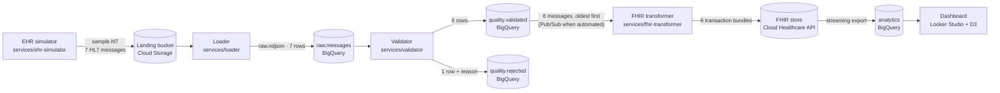

# HL7v2 ADT → FHIR R4 on Google Cloud

A proof of concept of a healthcare data pipeline: a regional analytics hub receives **HL7v2 ADT**
feeds (admit, update, discharge) from hospitals running a legacy EHR, lands them unchanged,
quarantines records that miss mandatory fields, converts the rest to **FHIR R4**, and reports
weekly patient flow.

**Small data, big-data shape.** The data is tiny on purpose (7 messages in the sample, at most
15 patients per generated batch, at most 50 rows on the dashboard). The components and their
wiring are the ones you would use at scale. All data is synthetic.


Design notes: [docs/ARCHITECTURE.md](docs/ARCHITECTURE.md).

## Services

One folder per service. Each has a `main.js` you can run by hand now and later deploy as the Cloud
Run job or service shown in the diagram. Shared code lives in `lib/`.

| Service | Folder | Runs on GCP as | Input → output |
|---|---|---|---|
| EHR simulator | `services/ehr-simulator` | Cloud Run job + Cloud Scheduler | → HL7 batch file (landing bucket) |
| Loader | `services/loader` | Cloud Run job | batch file → `raw.messages` (one row per message) |
| Validator | `services/validator` | Cloud Run job | `raw.messages` → `quality.validated` + `quality.rejected` |
| FHIR transformer | `services/fhir-transformer` | Cloud Run service (Pub/Sub push) | `quality.validated` → FHIR store |
| Dashboard | Looker Studio | managed | `analytics` (streamed from the FHIR store) → report |

| Shared | Folder | What it holds |
|---|---|---|
| HL7 helpers | `lib/hl7` | parser (CR, LF or CRLF), batch splitter by MSH, field readers, IST timestamps |
| Config | `lib/config` | every GCP resource name, from env vars or `.env` |

## Workflow at service level



## Example data, step by step

Real output from `data/sample.hl7` (2 patients + 1 malformed message). Control IDs and timestamps
change on every generation.

**1. EHR simulator → `data/sample.hl7`.** One patient's admit (A01), as the legacy EHR sends it:

```
MSH|^~\&|SYN-HIS|MANIPAL-SYN|PIPELINE|PIPELINE|20261020130501||ADT^A01^ADT_A01|SIM590330620000|P|2.5
EVN|A01|20261020130501
PID|1||MRN110867^^^MANIPAL-SYN^MR~09-8211-3542-6123^^^ABDM^ABHA||Prajapat^Balagopal||19820202|M|||1610 Reddy-Ganaka Club^^Mangaluru^Karnataka^575641^IN||+915092635519
PV1|1|O|OPD^R33^B2||||D8325^Rana^Ahalya||||||||||||V7985901|||||||||||||||||||||||||202610201305
```

The file holds 7 messages: this patient's A01 → A08 (phone changed) → A03, the same for a second
patient, and one emergency admit whose PV1-19 (visit number) is empty.

**2. Loader → `raw.messages`.** One row per message, stored unchanged, with a hash as the
idempotency key (reloading the same file creates nothing new):

```json
{ "msg_no": 1, "file_name": "sample.hl7",
  "message": "MSH|^~\\&|SYN-HIS|MANIPAL-SYN|PIPELINE|PIPELINE|20261020130501||ADT^A01…",
  "message_hash": "d65db8213a0aaae2eaf5967c744468cb3834c1c776f2f640e46c98c096171522",
  "loaded_at": "2026-10-22T08:50:33.188Z" }
```

**3. Validator → `quality.validated` (6 rows) and `quality.rejected` (1 row).**

```
VALID    #1 SIM590330620000 A01
VALID    #2 SIM590330620001 A08
VALID    #3 SIM590330620002 A03
VALID    #4 SIM590330620003 A01
VALID    #5 SIM590330620004 A08
VALID    #6 SIM590330620005 A03
REJECTED #7 SIM590330620006 A01  PV1-19 (visit number) is required
```

```json
{ "msg_no": 7, "control_id": "SIM590330620006", "trigger_event": "A01", "mrn": "MRN310560",
  "rules": "required_field:PV1-19", "reason": "PV1-19 (visit number) is required", "message": "…" }
```

**4. FHIR transformer → FHIR store.** Messages are applied oldest first. For the discharge (A03)
the bundle upserts the Patient and finishes the Encounter (abridged):

```json
{ "resourceType": "Bundle", "type": "transaction", "entry": [
  { "fullUrl": "urn:uuid:32460f7f-4741-5c4c-b3d7-07e0038cd5d4",
    "resource": { "resourceType": "Patient",
      "extension": [{ "url": ".../source-message-time", "valueDateTime": "2026-10-20T14:05:01+05:30" }],
      "identifier": [{ "system": "urn:syn:manipal:mrn", "value": "MRN110867" },
                     { "system": "https://healthid.ndhm.gov.in", "value": "09-8211-3542-6123" }],
      "name": [{ "family": "Prajapat", "given": ["Balagopal"] }],
      "gender": "male", "birthDate": "1982-02-02",
      "telecom": [{ "system": "phone", "value": "+917108777031" }] },
    "request": { "method": "PUT", "url": "Patient?identifier=urn%3Asyn%3Amanipal%3Amrn%7CMRN110867" } },
  { "fullUrl": "urn:uuid:20596f25-db46-534e-a400-5c6e880014fe",
    "resource": { "resourceType": "Encounter",
      "identifier": [{ "system": "urn:syn:manipal:visit", "value": "V7985901" }],
      "status": "finished", "class": { "code": "AMB" },
      "subject": { "reference": "urn:uuid:32460f7f-4741-5c4c-b3d7-07e0038cd5d4" },
      "period": { "start": "2026-10-20T13:05:00+05:30", "end": "2026-10-20T14:05:00+05:30" } },
    "request": { "method": "PUT", "url": "Encounter?identifier=urn%3Asyn%3Amanipal%3Avisit%7CV7985901" } } ] }
```

With `--send`, each message's result against the store:

```
SENT    SIM590330620000 A01 MRN110867  201 Created Patient/3/_history/1 | 201 Created Encounter/4/_history/1
SENT    SIM590330620001 A08 MRN110867  200 OK Patient/3/_history/2
SENT    SIM590330620002 A03 MRN110867  200 OK Patient/3/_history/3 | 200 OK Encounter/4/_history/2
```

Sending the same messages again changes nothing, and a late A01 after the discharge is skipped, so
the encounter stays `finished`:

```
SKIPPED SIM590330620000 A01 MRN110867  Encounter/4: stored version is from the same or a newer message
```

**5. FHIR store → `analytics`.** The store's streaming export keeps Patient and Encounter tables in
BigQuery in sync (not yet verified with data).

**6. Dashboard.** Looker Studio reads `analytics`: a table of encounters (≤ 50 rows) and the week's
encounters by class (inpatient / outpatient / emergency).

## Run it

```bash
npm install
cp .env.example .env            # fill in the landing bucket and FHIR store ID

npm run simulate -- --patients 2 --malformed 1 --seed 42 --out data/sample.hl7
npm run load                    # data/sample.hl7  -> data/raw.ndjson
npm run validate                # data/raw.ndjson  -> data/validated.ndjson + data/rejected.ndjson
npm run transform               # dry run: data/validated.ndjson -> data/bundles.ndjson
npm run transform -- --send     # write to the FHIR store in .env (uses `gcloud auth print-access-token`)
```

Each step prints the `bq load` command for its BigQuery table. `FHIR_BASE_URL` points the
transformer at another FHIR server (an emulator, for example).

## Manual run on GCP

| Step | State |
|---|---|
| 1–2 Project, APIs, landing bucket | done by hand |
| 3 Raw load | done by hand with a line-numbering workaround; now `npm run load` + `bq load` |
| 4 Validation | done in BigQuery SQL; found a generator bug (fixed). Now also `npm run validate` |
| 5–6 FHIR store + streaming to BigQuery | created; streaming **not yet verified with data** |
| 7 Send bundles | pre-flight done; next: `npm run transform -- --send` |
| 8 Analytics tables, 9 Looker Studio | not started |

Environment: project `hl7-fhir-pipeline`, region `asia-south1` for everything, BigQuery datasets
`raw`, `quality`, `analytics`, Healthcare dataset `hl7-fhir-pipeline-landing-fhir`, FHIR R4 store with
*update-create* and *referential integrity* on, streaming to `analytics` (Analytics V2 schema). The
Healthcare service agent needs **BigQuery Data Editor** and **BigQuery Job User** for streaming.

Mandatory rules (`services/validator/rules.js`): segments required by the structure (MSH, EVN, PID,
PV1 for both `ADT_A01` and `ADT_A03`), MSH-7, MSH-9 (ADT with A01/A03/A08), MSH-10, PID-3 with an MR
identifier, PID-5.1, PV1-2, PV1-19.

## Findings from the manual run

| # | Finding | Resolution |
|---|---|---|
| 1 | BigQuery does not keep file row order, so loading line by line loses which segment belongs to which message. | The loader splits on MSH itself and writes one row per message. |
| 2 | HL7 separates segments with CR; the file needed converting before loading. | The parser and splitter accept CR, LF and CRLF; messages are stored with CR. |
| 3 | 3 messages rejected instead of 1: A08s had no PV1, but A08 uses `ADT_A01`, which requires PV1. | The simulator adds PV1 to A08 and declares `ADT_A03` for A03; the validator checks required segments per structure. |
| 4 | City and state did not match (e.g. Belagavi, Uttarakhand). | Each hospital draws patients from nearby cities with matching state and PIN prefix. |
| 5 | Resource names differed from the plan ("dataset not found", "datastore not found"). | All names come from `lib/config` / `.env`. |
| 6 | Cloud Shell lost credentials after a restart. | See troubleshooting. |
| 7 | The FHIR store does not support `_summary=count`. | See troubleshooting. |

## Troubleshooting

- **401 `CREDENTIALS_MISSING` in Cloud Shell after a restart:** `gcloud auth print-access-token` comes back empty. Run `gcloud auth login` and `gcloud config set project hl7-fhir-pipeline`.
- **401 when opening a FHIR URL in the browser:** expected; the API needs a bearer token. Use `curl -H "Authorization: Bearer $(gcloud auth print-access-token)" …`.
- **`_summary=count` returns "not supported yet":** count the `entry` items of a search (fine at this size) or count rows in the BigQuery `analytics` tables.
- **"dataset not found" / "datastore not found":** compare `HEALTHCARE_DATASET` and `FHIR_STORE` in `.env` with the console, and check the region is `asia-south1`.

## FHIR mapping

| HL7 | FHIR |
|---|---|
| PID-3 (MR) | `Patient.identifier`, system `urn:syn:<hospital>:mrn` |
| PID-3 (ABHA) | `Patient.identifier`, system `https://healthid.ndhm.gov.in` |
| PID-5, PID-7, PID-8, PID-11, PID-13 | `name`, `birthDate`, `gender`, `address`, `telecom` |
| PV1-19 | `Encounter.identifier`, system `urn:syn:<hospital>:visit` |
| PV1-2 (I/O/E) | `Encounter.class` IMP / AMB / EMER |
| PV1-44 / PV1-45 (fallback MSH-7) | `Encounter.period` start / end (+05:30) |
| A01 / A03 | `Encounter.status` in-progress / finished (A08 updates the Patient only) |
| MSH-7, MSH-10 | extensions `source-message-time`, `source-control-id` |

**Newest message wins.** Before writing, the transformer reads the current Patient and Encounter
and compares their `source-message-time` with the incoming MSH-7: nothing stored → conditional PUT;
stored is older → `PUT {type}/{id}` with `If-Match` on the version; stored is the same or newer →
skipped. A 409/412 (someone else wrote in between) re-reads and retries, up to 3 times.

## Known gaps

- No automated tests: the services are checked by running them on the sample data (and the
  transformer's `--send` path against a local fake FHIR server).
- Validation rules exist twice: the BigQuery SQL from the manual run and `services/validator`.
  The validator should become the only source once it runs as the Cloud Run job.
- No GCP wiring yet: Cloud Run deployments, Workflows, Pub/Sub + dead letter, Eventarc, Scheduler,
  service accounts, Terraform.
- Streaming from the FHIR store to BigQuery is configured but not verified with data.

## Scale path

The same shape at real volume: Cloud Run jobs become Dataflow (Apache Beam) pipelines, the bucket and
BigQuery tables are partitioned by date and hospital, Cloud Workflows orchestrates the batch steps, and
Pub/Sub with a dead-letter topic sits in front of the quota-bound FHIR API.

The first version of this project (Kafka, MLLP, HAPI FHIR, React ops dashboard) is tagged `v0-kafka-fhir`.
