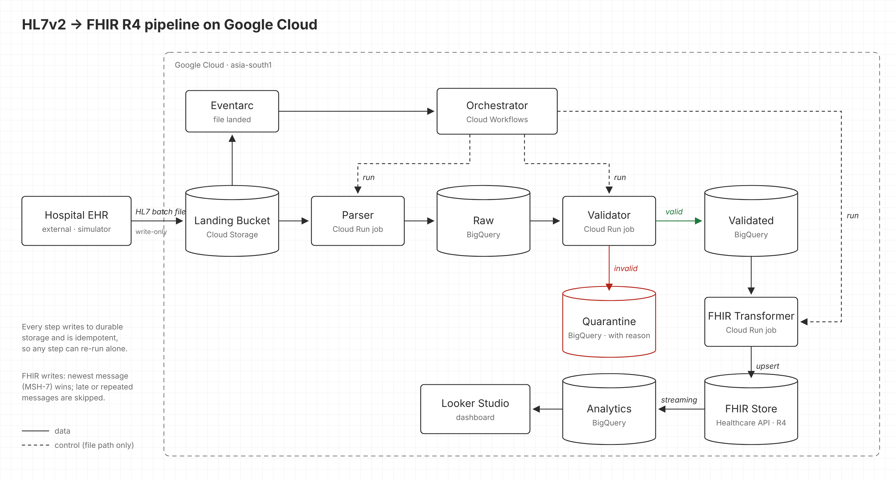
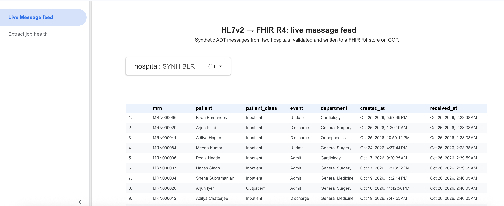
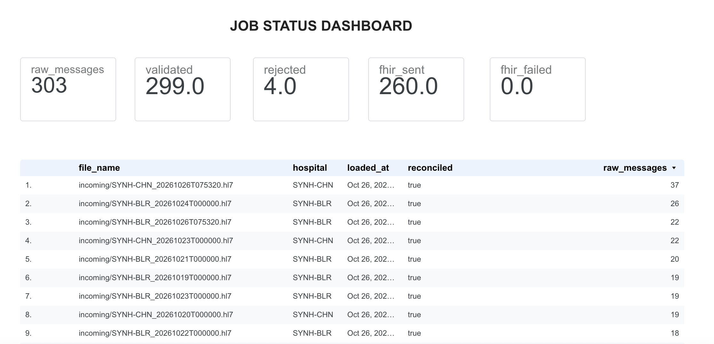
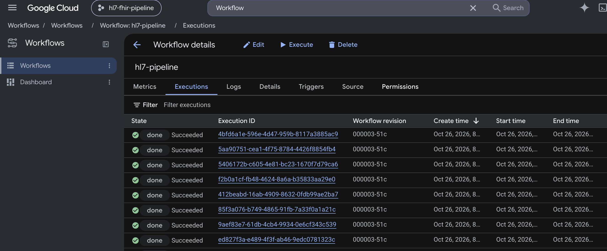

# HL7v2 → FHIR R4 pipeline on Google Cloud

## Introduction

Hospitals still exchange patient events as **HL7v2** messages. HL7v2 is a widely used standard,
but its pipe-delimited format is hard to query, report on or share with modern systems. **FHIR**
is the modern standard that national networks (such as ABDM), apps and analytics tools expect.

This project is a proof of concept for that gap. A hospital's EHR sends ADT messages (admit,
update, discharge) as HL7v2 files; a pipeline on managed Google Cloud services validates them,
converts them to FHIR R4, stores them in a FHIR store, and makes them available for patient
dashboards. All data is synthetic.

**Dashboard:** *Looker Studio link*

## Example: HL7v2 in, FHIR out

An emergency admission (ADT^A01) as the hospital sends it:

```
MSH|^~\&|SYN-EHR|SYNH-CHN|HUB|HUB|20261017005212+0530||ADT^A01^ADT_A01|SYNEHR000000001|P|2.5
EVN|A01|20261017005212+0530
PID|1||MRN000001^^^SYNH-CHN^MR~51-0802-0035-1253^^^ABDM^ABHA||Nair^Ayesha||19651002|F|||196 Main Road^^Belagavi^Karnataka^590660^IN||+917942825073
PV1|1|E|ER^R30^B6^SYNH-CHN||||D1001^Raman^Sunita|||EMR|||||||||V0000001|||||||||||||||||||||||||20261017005212+0530|
```

The same event in the FHIR store, as a Patient and an Encounter (abridged):

```json
{
  "resourceType": "Patient",
  "identifier": [
    { "system": "urn:syn:synh-chn:mrn", "value": "MRN000001" },
    { "system": "https://healthid.ndhm.gov.in", "value": "51-0802-0035-1253" }
  ],
  "name": [{ "family": "Nair", "given": ["Ayesha"] }],
  "gender": "female",
  "birthDate": "1965-10-02",
  "address": [{ "city": "Belagavi", "state": "Karnataka", "postalCode": "590660", "country": "IN" }]
}
```

```json
{
  "resourceType": "Encounter",
  "identifier": [{ "system": "urn:syn:synh-chn:visit", "value": "V0000001" }],
  "status": "in-progress",
  "class": { "system": "http://terminology.hl7.org/CodeSystem/v3-ActCode", "code": "EMER", "display": "emergency" },
  "subject": { "reference": "Patient/<id>" },
  "period": { "start": "2026-10-17T00:52:12+05:30" },
  "participant": [{ "individual": { "display": "Dr. Sunita Raman" } }],
  "serviceProvider": { "display": "SYNH-CHN" }
}
```

When the discharge (ADT^A03) arrives, the same Encounter is updated to `finished` with an end time,
rather than a new one being created.

## Why Google Cloud?

Google Cloud offers a managed **FHIR store** through the **Cloud Healthcare API**: a FHIR R4 server
with validation, versioning and search built in, so the pipeline does not have to run its own. The
store also streams every change into **BigQuery**, which gives analytics on FHIR data without a
separate export job.

## Workflow and architecture



A hospital's EHR system sends HL7v2 batch files to a **landing bucket** on Google Cloud, using an
account that can only add files. The data is synthetic; see [Synthetic data](#synthetic-data).

An **Eventarc** trigger notices each new file and starts the **orchestrator** (Cloud Workflows),
which runs three Cloud Run jobs in order. It passes them only the file's location; each job reads
its data from the previous step's storage.

1. **Parser** reads the file, splits it into individual HL7 messages and stores each one unchanged
   in the **Raw** table (BigQuery).
2. **Validator** checks that every message has its mandatory segments and fields (MRN, visit
   number, event type and more). Messages that fail go to **Quarantine** with the reason, so the
   hospital team can review and correct them. Valid messages go to the **Validated** table.
3. **FHIR transformer** maps each valid message to a FHIR Patient and Encounter and writes them to
   the **FHIR store**. The store streams every change into the **Analytics** dataset in BigQuery,
   where views keep the latest version of each encounter and count admissions and discharges per
   day, hospital and patient class. The dashboard reads these views, together with a per-message
   trail from file to FHIR resource.

## Dashboard


**Page 1:** every message received, with patient, event and outcome, and below it the pipeline
health: messages received, validated, quarantined and written to FHIR, per file.


**Page 2:** patient flow from the FHIR data: admissions and discharges per day by patient class.


**Deployment:** the workflow runs, Cloud Run jobs and FHIR store on Google Cloud.

## Learnings

**Why the orchestrator pattern?** The batch steps are few and strictly ordered, and an orchestrator
gives one place to see where each file is and to retry a failed step. The services never call each
other, so each one can still be changed or re-run on its own.

**How is idempotency achieved?** Every message is stored under a SHA-256 hash of its content, so
re-sending a file adds nothing. FHIR writes are keyed on MRN and visit number, and the newest
message (by its HL7 timestamp) wins, so late or repeated messages never overwrite newer data.

## Future plans

1. **Event-driven processing:** replace the orchestrator with Pub/Sub between the steps, ordered by
   patient, with a dead-letter queue, so the pipeline scales per message rather than per file.
2. **Scheduled sending from the EHR:** a scheduler on the hospital side that sends new batches to
   the landing bucket automatically.
3. **CI/CD with GitHub Actions:** run checks on every pull request and deploy on merge to `main`.

## Setup

### Synthetic data

The hospital EHR is simulated with
[tool-patient-generator](https://github.com/rajkumarElango96/tool-patient-generator), forked from
Jose-Tomas Salvador's open-source HL7 message generator. The fork adds patient journeys
(admit → update → discharge) that continue between runs, Indian names and addresses with MRN and
ABHA identifiers, a small rate of deliberately broken or duplicated messages, and an uploader that
sends batch files to the landing bucket.

### Deploy

Needs a Google Cloud project with billing, `gcloud` (signed in as a project owner) and Node 22.

```bash
git clone https://github.com/rajkumarElango96/hl7-fhir-pipeline-gcp.git
cd hl7-fhir-pipeline-gcp
npm install

PROJECT=<project-id> ./infra/setup.sh     # once: bucket, datasets, FHIR store, service accounts
# then run the deploy command that setup.sh prints, for example:
PROJECT=<project-id> BUCKET=<project-id>-landing HC_DATASET=hl7-fhir FHIR_STORE=fhir-r4 ./infra/deploy.sh
```

- `setup.sh` creates the landing bucket, the BigQuery datasets, the FHIR R4 store with streaming
  to BigQuery, and two service accounts: one for the pipeline, and a write-only one for the hospital.
- `deploy.sh` builds the container image, deploys the three Cloud Run jobs and the workflow, and
  creates the trigger. Run it again after any code change.

### Run

Send a batch file from the simulator (or upload `data/sample.hl7` to `gs://<bucket>/incoming/`),
then follow it:

```bash
gcloud workflows executions list hl7-pipeline --location=asia-south1 --limit=3
bq query --use_legacy_sql=false < infra/views.sql     # once, after the first file
bq query --use_legacy_sql=false 'SELECT * FROM quality.pipeline_health'
```
