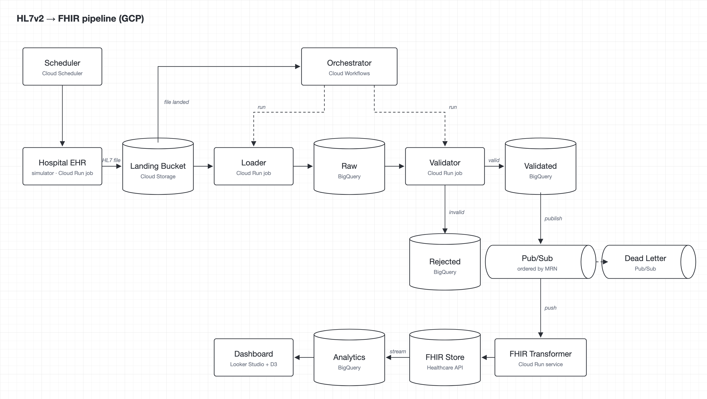

# Architecture

## Flow
1. **Hospital EHR** (simulator, Cloud Run job, triggered by Cloud Scheduler) writes a batch file of HL7v2 ADT messages.
2. **Landing Bucket** (Cloud Storage) keeps every file unchanged, organised as `hospital=…/date=…/`. It is the replay source.
3. A new file triggers the **Orchestrator** (Cloud Workflows, a managed service defined in YAML). It only passes the file path and runs the steps in order with retries; it never touches the data.
4. **Loader** (Cloud Run job) reads the file from the bucket and writes each message as-is to **Raw** (BigQuery, append-only). A content hash makes reloads harmless.
5. **Validator** (Cloud Run job) checks mandatory fields on rows loaded since its last run. Failures go to **Rejected** (BigQuery) with a reason per rule; passes go to **Validated** (BigQuery).
6. Validated messages are published to **Pub/Sub** (ordering key = patient MRN). Messages that fail delivery 5 times go to a **Dead Letter** topic.
7. **FHIR Transformer** (Cloud Run service, push subscription) converts each message to FHIR Patient + Encounter and upserts them into the **FHIR Store** (Cloud Healthcare API).
8. The FHIR store streams into **Analytics** (BigQuery), which **Dashboard** (Looker Studio with a D3 community visualization) reads.

## Why these choices
| Decision | Reason |
|---|---|
| Durable layer between every step (bucket → raw → validated → FHIR) | Any step can be re-run from the layer before it; failures stay local. |
| Orchestration for the batch steps, Pub/Sub only before the FHIR API | Workflows is simpler for ordered batch steps. The queue is used only where it is needed: buffering against the FHIR API's quota, per-record retries with a dead letter, and per-patient ordering. |
| Control separate from data | The orchestrator passes file paths; services read data from storage directly. |
| Validation separate from transformation | Different workloads (set-based scan vs quota-bound writes), different failure handling (quarantine vs retry), independent reprocessing and scaling. |
| Idempotent at every step | Delivery is at-least-once: content hash on load, conditional FHIR upserts on MRN / visit number, newest message (MSH-7) wins. |
| FHIR store + BigQuery | FHIR store for clinical interoperability; BigQuery for analytics. Looker Studio reads BigQuery natively. |

## POC limits
≤ 15 patients and ≤ 5 malformed messages per generated batch; ≤ 50 rows on the dashboard.
At real volume the Cloud Run jobs would become Dataflow (Apache Beam) pipelines; the shape stays the same.
